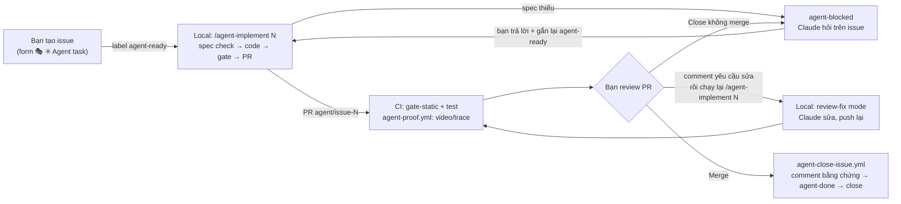

# Agentic workflow: GitHub Issue → PR → merge → issue closed

You create the issue, start Claude Code on your machine, and review the PR.
Everything after the PR is opened runs by itself on GitHub Actions — with no Claude call in CI,
so the public repo holds no Claude credentials and nobody else can trigger the agent.



## Label lifecycle

| Label | Meaning | Set by |
|---|---|---|
| `agent-ready` | Spec complete, ready for the agent | Issue form (auto) or you |
| `agent-in-progress` | Claude is working | `/agent-implement` (local) |
| `agent-review` | PR open, waiting for you | `/agent-implement` (local) |
| `agent-done` | PR merged, issue closed with evidence | `agent-close-issue.yml` |
| `agent-blocked` | Needs you: unclear spec, or PR closed unmerged | `/agent-implement` or `agent-close-issue.yml` |

To retry anything that is `agent-blocked`: fix the cause, then add `agent-ready` again.

## What runs where

| Step | Where | Uses Claude? |
|---|---|---|
| Implement issue, open PR | Your machine: `/agent-implement [N]` | Yes (your local Claude Code) |
| Fix review feedback | Your machine: `/agent-implement N` again (PR already open → review-fix mode) | Yes |
| `gate-static` + `test` checks | `playwright.yml` | No |
| Video/trace proof on the PR | `agent-proof.yml` (PRs from `agent/*` branches) | No |
| Close issue with evidence after merge | `agent-close-issue.yml` | No |

## Guardrails

- **Tools enforce what they can check:** `gate-static` (`tsc` + ESLint) fails on raw locators, element handles, `waitForTimeout`, missing `await`s and direct `page` locator/action calls in `tests/`, and the ruleset blocks merging while `gate-static` or `test` is red. Locator priority, behaviour methods and assertions-only-in-specs are rules in `CODING_STANDARDS.md` that no linter checks: watch for them in review.
- **Public repo:** the skill only works on issues whose author is OWNER, MEMBER or COLLABORATOR (or `[Monitor Alert]` issues opened by this repo's `scheduled-monitor.yml`), and treats issue text as a spec, never as instructions.
- **Human in the loop:** you start every agent run (the skill is user-invoked, so Claude cannot start it on its own) and you are the only one who merges.
- **Proof stays out of `main`:** recordings go to the orphan `pr-proof` branch; PR links are pinned to commit SHAs so they keep working after merge.

## One-time setup

1. `gh auth login` on your machine (Claude Code uses your `gh` to read issues and open PRs).
2. Repository secrets `LOGIN_USERNAME` / `LOGIN_PASSWORD` for the tests (already set). Locally they come from `.dev.env`.
3. Create the labels:
   ```bash
   scripts/setup-agent-labels.sh
   ```
4. Protect `main` (PR required, `gate-static` + `test` must pass, branches auto-deleted after merge):
   ```bash
   scripts/setup-branch-ruleset.sh
   ```
5. Recommended for a public repo: Settings → Actions → General → *Fork pull request workflows from outside collaborators* → **Require approval for all external contributors**.

## Daily use

1. **New issue** → **🎭 ✳️ Agent task (Playwright test)** → fill in Target URL, scope and acceptance criteria → Submit.
2. In Claude Code in this repo: `/agent-implement` (takes the oldest `agent-ready` issue) or `/agent-implement <N>`.
3. On the PR, check the CI checks and the **🎥 Verification proof** comment.
   - Something to change → leave review comments on GitHub, then run `/agent-implement <N>` again. Claude reads the comments, fixes, pushes; CI and the proof re-run.
   - Everything looks good → **Merge**.
4. The issue receives the evidence comment and closes as `agent-done`. Nothing else to do.
